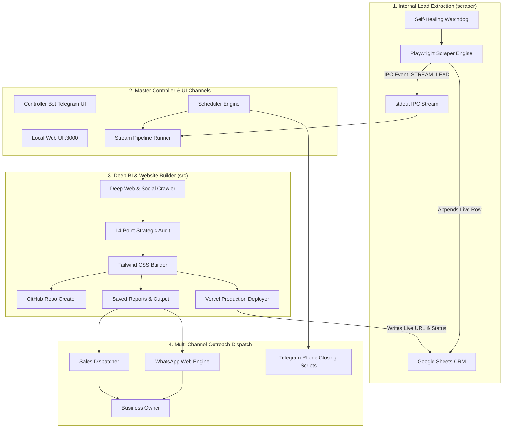

# 🌐 Arclane Studios — Autonomous Client Acquisition & Growth Ecosystem


An enterprise-grade, multi-agent autonomous system built specifically to capture, enrich, convert, and onboard Indian local businesses (Gyms, Salons, Spas, Clinics, Cafes) on 100% autopilot.

> 📚 **Official Documentation Hub:**
> - [**ArcLane Business Understanding & Intelligence**](docs/ARCLANE_BUSINESS_UNDERSTANDING.md) — Comprehensive business model, unit economics, value-first framework, and 100-day targets.
> - [**Revenue Generation Playbook**](docs/ARCLANE_REVENUE_PLAYBOOK.md) — Service pillars, pricing packages, case studies, and closing psychology.
> - [**Outreach Strategy & Commercial Offers**](docs/OUTREACH_OFFERS_INDIA.md) — 10 tailored commercial offers for Indian SMBs.
> - [**Full System Architecture**](docs/ARCHITECTURE.md) — End-to-end multi-agent subsystem blueprint.
> - [**Free Cloud Deployment Guide**](docs/FREE_CLOUD_DEPLOYMENT_PLAN.md) — Render & Oracle Cloud deployment plan.
> - [**Server Deployment & PM2 Setup**](docs/SERVER_DEPLOYMENT_GUIDE.txt) — 24/7 Linux server deployment instructions.
> - [**Security & Secrets Policy**](docs/SECURITY.md) — Redaction standards, CSP rules, and secret protection.

This comprehensive manual covers **the entire unified system:** from Google Maps scraping mechanics (now directly housed under `scraper/`) and real-time streaming architectures to website generation, Vercel deployments, WhatsApp automation, dual Telegram + Web UI control channels, and 24/7 server operations.

---

## 📑 Table of Contents

1. [System Architecture & Lifecycle](#1-system-architecture--lifecycle)
2. [Pillar 1: Google Maps AI Scraper (`scraper/`)](#2-pillar-1-google-maps-ai-scraper-scraper)
3. [Pillar 2: 24/7 Master Controller Bot (`controller_bot/`)](#3-pillar-2-247-master-controller-bot-controller_bot)
4. [Pillar 3: Dual Control Channel (Telegram Bot & Local Web UI)](#4-pillar-3-dual-control-channel-telegram-bot--local-web-ui)
5. [Pillar 4: Deep Business Intelligence & Website Builder (`src/`)](#5-pillar-4-deep-business-intelligence--website-builder-src)
6. [Pillar 5: WhatsApp Web Curiosity Engine (`src/whatsapp_sender.js`)](#6-pillar-5-whatsapp-web-curiosity-engine-srcwhatsapp_senderjs)
7. [Pillar 6: Sales Email Dispatcher Bot (`scripts/sales_bot.py`)](#7-pillar-6-sales-email-dispatcher-bot-sales_botpy)
8. [Complete Command & CLI Reference](#8-complete-command--cli-reference)
9. [Google Sheets CRM Schema & Status Lifecycle](#9-google-sheets-crm-schema--status-lifecycle)
10. [Installation, Prerequisites & Environment Variables](#10-installation-prerequisites--environment-variables)
11. [24/7 Production Deployment & Autostart (PM2 & Systemd)](#11-247-production-deployment--autostart-pm2--systemd)
12. [Troubleshooting & Emergency Playbook](#12-troubleshooting--emergency-playbook)

---

## 1. System Architecture & Lifecycle

The entire ecosystem is unified in this repository, linking the internal scraper (`scraper/`) and pipeline controller (`controller_bot/`) into a seamless **Producer-Consumer Streaming Architecture:** 



---

## 2. Pillar 1: Google Maps AI Scraper (`scraper/`)

Located directly inside `scraper/`. A military-grade Playwright scraper with multi-model AI inference (Gemini Flash Lite + OpenRouter) designed for multi-day uninterrupted execution.

### Key Components:
1. **`scraper_no_website.py` (Fast High-Value Hunter):**
   * Targets Indian local businesses with missing, invalid, or broken website links.
   * Extracts Name, Phone, Address, Timings, Rating, Review Count, and Google Maps URL.
   * **Multi-Source Phone Extraction:** Discovers Indian phone numbers via direct phone tags, WhatsApp `wa.me` URLs, `tel:` links, and whole-page DOM regex scanning (`+91`, `0`, 10-digit mobile).
   * Emits structured JSON events `[STREAM_LEAD]: {...}` via `stdout` for real-time consumer streaming.
2. **`scraper.py` (Deep Scraper with AI Reviews):**
   * Dual-pass review extraction (Most Relevant + Lowest Rating).
   * Analyzes customer pain points to generate precision sales hooks.
3. **`run_forever.py` (24/7 Memory-Safe Runner):**
   * Runs the scraper in controlled chunks (default: 50 leads per pass).
   * Gracefully closes Chromium and reclaims OS memory between chunks to eliminate memory leaks.
4. **`telegram_bot.py` (Standalone Scraper Command Center):**
   * Remote control of scraping jobs via dedicated Telegram commands.
   * Watchdog monitors Chromium output and auto-restarts the browser if deadlocked for $>3$ minutes.
5. **State & Deduplication:**
   * `scraped_places.txt`: Tracks all scraped Google Place URLs so restarts never process duplicate businesses.
   * `google_maps_leads.xlsx`: Local Excel spreadsheet compiled automatically after each job.

---

## 3. Pillar 2: 24/7 Master Controller Bot (`controller_bot/`)

Located in `controller_bot/`. The central autonomous coordinator that schedules and runs your daily timetable on 100% autopilot.

### Daily Automated Schedule (`Asia/Kolkata` Timezone):
* **12:00 PM — 📲 Morning WhatsApp Dispatch Wave:**
  Pulls the first batch of 18 ready websites and dispatches curiosity messages via WhatsApp Web (30–75s human delays).
* **04:30 PM — 📲 Afternoon WhatsApp Dispatch Wave:**
  Dispatches the remaining 17 leads during the late-afternoon engagement window.
* **06:00 PM — 📞 Deal-Closing Phone Alert:**
  Pushes follow-up reminders and Hindi/English phone scripts to Telegram/Web UI to close ₹7,999 deals over 2-minute calls.
* **06:00 AM — 🌅 Morning Real-Time Streaming Scrape & Build:**
  Spawns `scraper/scraper_no_website.py` in the morning for today's designated city and query. As each lead is extracted from Google Maps, it immediately triggers the deep crawl, 14-point audit, and Vercel website deployment for that lead in parallel while scraping continues.
* **07:30 AM — ⚙️ Morning Safety Sweep Analysis:**
  Checks Google Sheets for any unprocessed or manually inserted leads and builds websites for them so that today's batch is 100% ready.

### Weekly Strategic Plan (`plan/week_1_plan.json`):
* **Monday:** Gyms & Fitness Centers in Pune (Target: 35 Leads)
* **Tuesday:** Fitness Studios & Gyms in Surat (Target: 35 Leads)
* **Wednesday:** Premium Unisex Salons in Gurugram (Target: 35 Leads)
* **Thursday:** Dental & Specialty Care Clinics in Ahmedabad (Target: 35 Leads)
* **Friday:** Fitness Gyms & CrossFit in Jaipur & Indore (Target: 35 Leads)
* **Saturday:** Spas & Wellness Studios in Chandigarh (Target: 35 Leads)
* **Sunday:** Lucknow Pipeline Review, Domain Mapping & Balance Collection (Target: 20 Leads)

---

## 4. Pillar 3: Dual Control Channel (Telegram Bot & Local Web UI)

The ecosystem provides **redundant, zero-downtime management** through two synchronized interfaces:

1. **Telegram Controller Bot (`@ArclaneControllerBot`):**
   * Full remote control from any smartphone.
   * Inline buttons for one-tap execution (`/start`, `/status`, `/run_full`, `/abort`, etc.).
   * TLS fallback: If Telegram's polling socket disconnects, the system logs a warning without crashing.
2. **Local Web UI (`http://localhost:3000`):**
   * Built-in Express.js + Socket.IO offline interface.
   * **Full Feature Parity:** Supports all slash commands and interactive quick-action buttons.
   * **Bidirectional Chat Sync:** Messages, system notifications, and commands sent on Telegram reflect on the Web UI, and vice versa.
   * **Local History Persistence:** Preserves chat sessions across restarts in `web_ui_history.json`.

---

## 5. Pillar 4: Deep Business Intelligence & Website Builder (`src/`)

### A. Deep Web Crawler (`src/scraper.js`)
* Crawls the prospect's existing web presence (homepage, `/about`, `/services`, `/contact`, `/blog`).
* Employs Chromium stealth configurations to bypass anti-bot challenges and extract raw content.

### B. 14-Point Strategic Audit (`src/summarizer.js` + `src/system_prompt.txt`)
* Powered by Google Gemini Flash Lite / OpenRouter LLMs.
* Evaluates SWOT, Mobile UX Deficiencies, SEO gaps, Local Reputation, and generates SPIN sales hooks and responsive website design prompts.
* Writes markdown report to `reports/<clientId>/audit.md`.

### C. Website Builder & Agency Subdomain Publisher (`src/builder.js` + `src/agency_publisher.js`)
* **Code Generation:** Converts the Antigravity prompt into a complete, responsive mobile-first Tailwind CSS website (`generated_sites/<clientId>/index.html`).
* **Design Quality Enforcement:**
  * Header is 100% solid/opaque (`bg-[#09090b]` or `bg-white`) with zero transparent overlay bugs.
  * Mobile drawer menu sits with top-11/12 breathing room, `rounded-tl-2xl` corner, backdrop blur overlay (`z-[90]`), and drawer `z-[100]`.
  * Fluid typography on H1/H2 (`text-2xl sm:text-4xl md:text-5xl lg:text-5xl xl:text-6xl break-words`) to prevent mobile word clipping.
  * Sticky mobile action bar with glowing Call Now and WhatsApp buttons (`pb-28` body padding).
* **Agency Subdomain Batch Hosting (`*.arclanestudios.space`):**
  * **No Individual Vercel Projects:** Rather than spamming separate Vercel projects and git repositories, each client site is staged directly inside [`web-dev-agency/public/sites/<slug>/index.html`](file:///c:/Users/Ameya%20Sharma/Downloads/arclane-autonomous-acquisition-engine/web-dev-agency/public/sites).
  * **Batch Trigger (Every 5 Leads):** Automatically commits and pushes to GitHub (`ameyasharma-ai/WEB-DEV-AGENCY`) after every 5 scrapes, triggering a single unified Vercel deployment.
  * **End-of-Run Sweep:** Any remaining leads that do not form a full batch of 5 are automatically swept and deployed to production as soon as the scraper finishes.
  * **Subdomain URL Structure:** Every business receives a clean, high-conversion URL: `https://<business-slug>.arclanestudios.space` (and fallback `https://www.arclanestudios.space/sites/<business-slug>`).
  * **Subdomain Isolation:** Next.js middleware and layout isolation detect client subdomains and strip the agency header, footer, and navigation so the client site looks 100% standalone.
* **Report Structuring:**
  * Writes structured metadata to `reports/<clientId>/outreach.json` and `outreach.txt`.
  * Updates Google Sheets with the live branded subdomain URL and sets status to `Website Built`.

---

## 6. Pillar 5: WhatsApp Web Curiosity Engine (`src/whatsapp_sender.js`)

* **Address Book vCard Exporter:** Exports batches of contacts as `.vcf` files so you can import them into your phone's address book with 1 tap.
* **Persistent Session:** Uses `whatsapp_user_session/` so you only scan the QR code once.
* **Anti-Ban Architecture:**
  * Randomized 30–75s intervals between messages.
  * Human-like keystroke delays during text insertion.
  * Splits sends into 18 at 12:00 PM and 17 at 04:30 PM.
* **Curiosity-Driven Hook:** Sends a short, non-salesy message sharing their custom live demo website link.

---

## 7. Pillar 6: Sales Email Dispatcher Bot (`scripts/sales_bot.py`)

A stateless Python Telegram bot for email-based outreach:
* **Inline Button Navigation:** Sends `/scan` to browse all generated leads with pagination.
* **Rich HTML Templates:** Automatically wraps plain text drafts into styled HTML emails.
* **SEO Audit Attachment:** Parses `reports/<id>/audit.md`, renders it with a premium CSS stylesheet, and attaches it as `Website_UX_SEO_Audit.html`.
* **Anti-Duplication:** Checks Google Sheets notes to ensure no lead is emailed twice.

---

## 8. Complete Command & CLI Reference

### 🚀 A. Quick-Start & Daily Run Commands

| Command / Script | Environment / Runtime | Operational Action |
| :--- | :--- | :--- |
| `npm start` or `npm run controller` | Node.js / Express / Socket.io | Launches the Master Controller Bot and boots the Local Web UI on `http://localhost:3000`. |
| `npm run fix -- <id>` | Node.js | Re-audits, regenerates assets, and rebuilds a specific client website by Client ID (e.g. `npm run fix -- 202`). |
| `npm run prune` | Node.js / Vercel API | Prunes stale or redundant preview deployments on Vercel to preserve deployment slots. |
| `npm run whatsapp` | Node.js / Playwright | Launches the standalone WhatsApp Web automation and contact sync engine. |
| `python scraper/telegram_bot.py` | Python 3.10+ | Starts the standalone Google Maps Scraper Command Center Telegram bot. |
| `python scripts/sales_bot.py` | Python 3.10+ | Starts the rich HTML sales email dispatcher bot with inline Telegram lead inspection. |
| `fix_clock.bat` | Windows CMD / PowerShell | Synchronizes local system clock against Google servers to prevent JWT expiration errors on Google Sheets API. |

---

### 🎯 B. Fast Test Run: 10 Gyms in Patna

To run an autonomous test batch of **10 Gyms in Patna** with real-time scraping, website building, and agency subdomain batch deployment:

#### Method 1: Via Local Web UI (Port 3000)
1. Start the controller bot & Web UI server:
   ```powershell
   npm start
   ```
2. Open your browser to `http://localhost:3000` and navigate to the **💬 Bot Terminal** tab.
3. Tap the **⚡ /trigger_stream** quick pill or send into the command bar:
   ```text
   /trigger_stream Gyms Patna 10
   ```
   *(Or for full pipeline with automated WhatsApp curiosity pitch: `/run_full Gyms Patna 10`)*.

#### Method 2: Via Telegram Controller Bot
Send directly to `@ArclaneControllerBot`:
```text
/trigger_stream Gyms Patna 10
```

#### Method 3: Direct CLI Invocations
```powershell
# Real-Time Stream Scrape & Build
node -e "
import('./controller_bot/pipeline_runner.js').then(async ({ PipelineRunner }) => {
    const { ScraperRunner } = await import('./controller_bot/scraper_runner.js');
    const runner = new PipelineRunner();
    const scraper = new ScraperRunner();
    await runner.runStreamingScrapeAndBuild({
        query: 'Gyms',
        locality: 'Patna',
        city: 'Patna',
        targetLeads: 10,
        scraperRunner: scraper
    });
});
"

# Instant Website Synthesis from Google Maps Link
node -e "
import('./src/engine/instant_maps_builder.js').then(async ({ instantMapsBuilder }) => {
    await instantMapsBuilder.processMapsUrl('https://maps.app.goo.gl/...', {
        notify: (msg) => console.log(msg)
    });
});
"
```

---

### 🤖 C. Master Controller Bot & Chat UI Commands Manual

The Controller Bot (accessible in Telegram and at `http://localhost:3000`) provides comprehensive pipeline control:

| Command & Aliases | Arguments & Syntax | Category | Detailed Operational Description |
| :--- | :--- | :--- | :--- |
| `/help`, `/commands`, `/cmd` | None | Help & Manual | Displays full interactive command manual with copy-paste examples and navigation buttons. |
| `/status` | None | Monitoring | Displays live system health, RAM, active task state, current IST time, and today's cron timetable. |
| `/today` | None | Strategy | Displays today's designated niche, target city, lead quota, and phone-closing scripts. |
| `/run_full` (or `/trigger_full`) | `[query] [city] [count]` | Pipeline | Executes complete 360° pipeline: Scrape ➔ 14-Point AI Audit ➔ Tailwind Website ➔ Vercel Deploy ➔ WhatsApp Curiosity Pitch. *(Ex: `/run_full Gyms Patna 1`)* |
| `/trigger_stream` (or `/stream_scrape`) | `[query] [city] [count]` | Pipeline | Concurrent real-time streaming pipeline: streams leads from Google Maps straight into the builder queue and auto-deploys to `arclanestudios.space`. *(Ex: `/trigger_stream "Gyms" "Patna" 10`)* |
| `/stream_scrape_vision` (or `/vision`) | `[query] [locality] [city] [count]` | Vision Pipeline | Crawls authentic Google Maps photos, applies Gemini Vision classification, stages HD assets locally, and builds high-conversion prototype. |
| `/auto_explore` | `[query] [city] [target]` | Exploration | Autonomous multi-locality hopping chain across commercial corridors until target volume is satisfied. *(Ex: `/auto_explore "Gyms" "Patna" 33`)* |
| `/build_url` | `<maps_url>` (or paste link) | Instant Builder | Instantly scrapes, audits, and builds a website directly from any Google Maps URL without sheet pre-configuration. |
| `/fix`, `/build`, `/rebuild` | `<id>` or `<start:end>` | Lead Repair | Re-synthesizes a specific lead or batch range (max 30) with updated assets, styling, and Google Sheet sync. *(Ex: `/fix 202` or `/fix 1:10`)* |
| `/trigger_scrape` | `[query] [city] [count]` | Data Ingestion | Scrapes Google Maps leads and writes them into Sheet1 without triggering builds or outreach. *(Ex: `/trigger_scrape "Gyms" "Patna" 20`)* |
| `/trigger_analyse` | `[maxLeads]` | Site Generation | Evaluates pending scraped leads in Sheet1, runs 14-point AI audit, and compiles mobile-first websites. *(Ex: `/trigger_analyse 5`)* |
| `/trigger_send` | `[count]` | Outreach | Dispatches WhatsApp curiosity messages to leads with built sites via WhatsApp Web with 30-75s human delays. *(Ex: `/trigger_send 10`)* |
| `/approve`, `/launch` | None | Green Gate | Approves and launches the queued WhatsApp outreach wave after operator inspection of `.vcf` contacts. |
| `/coverage` | `[niche] [city]` | Intelligence | Queries `data/locality_coverage.json` to display micro-locality coverage rates, lead totals, and pending expansion zones. |
| `/view_plan`, `/plan` | None | Strategy | Displays active 100-day schedule JSON configuration path and current cycle day. |
| `/pause_auto` | None | Safeguards | Pauses the 24/7 background cron automation. Manual command execution remains enabled. |
| `/start_auto` | None | Safeguards | Resumes the 24/7 background cron automation in `Asia/Kolkata` timezone. |
| `/reset_plan` (or `/resume_plan`) | None | Safeguards | Aborts any active manual tasks, flushes queues, and restores autonomous 24/7 timetable. |
| `/login` | None | Session | Launches headed Chromium browser session to authenticate WhatsApp Web QR code into `whatsapp_user_session/`. |
| `/abort`, `/stop` | None | Kill Switch | Emergency Halt: Transmits `SIGTERM` to kill all active Playwright, Puppeteer, and builder child processes. |

---

### 🔍 D. Standalone Google Maps Scraper CLI & Bot Commands

The scraper engine housed in `scraper/` can also operate independently:

```bash
# Fast scraper variant targeting businesses WITHOUT websites:
python scraper/scraper_no_website.py --query "Gyms" --locality "in Patna" --city "Patna" --target 33

# Deep scraper with dual-pass AI review analysis:
python scraper/scraper.py --query "Gyms in Pune" --leads 35 --chunk_size 50

# Memory-safe 24/7 continuous runner (auto-restarts Chromium between chunks):
python scraper/run_forever.py
```

#### Scraper Telegram Bot (`scraper/telegram_bot.py`):
| Command | Description | Example Usage |
| :--- | :--- | :--- |
| `/scrape [flags]` | Launches a new Google Maps scraping job | `/scrape --query "Gyms" --locality "in Pune" --city "Pune" --leads 35` |
| `/stop` | Safely terminates active scraper, shuts browser, compiles Excel | `/stop` |
| `/status` | View live heartbeat, RAM usage, and extracted leads count | `/status` |
| `/logs` | Returns the last 50 lines of live terminal output to Telegram | `/logs` |
| `/ping` | Health check verifying bot & Chromium state | `/ping` |
| `/pause [minutes]` | Temporarily sleeps scraper process without closing browser | `/pause 30` |
| `/resume` | Wakes scraper from paused state | `/resume` |

#### Scraper CLI Flags:
* `--query "keyword"`: Industry / category to search (e.g. `"Gyms"`, `"Unisex Salons"`).
* `--locality "in City"`: Maps search locality modifier (e.g. `"in Pune"`).
* `--city "CityName"`: City name for CRM tagging.
* `--leads N`: Number of leads to extract (default: 35).
* `--no_website`: Fast scraper variant targeting businesses without websites.
* `--no_agent_smith`: Disables autonomous LLM query generation upon completion.
* `--chunk_size N`: Flushes RAM cache every N leads.
* `--end_date YYYY-MM-DD`: Schedules automatic scraper stop date.

---

### 🛠️ E. Maintenance, Diagnostics & Repair Scripts

The `scripts/` directory provides essential operational tools:

| Script Command | Purpose & Description |
| :--- | :--- |
| `node scripts/audit_live_501_sites.cjs` | Live HTTP probes across all 501 hosted sites on `arclanestudios.space/sites/*` verifying HTTP 200, tel/wa link validity, and placeholder token absence. |
| `node scripts/auto_commit.js` | Automatically stages, commits, and pushes major codebase updates across the Arclane Engine and the nested `web-dev-agency` repository to GitHub `origin main`. |
| `node scripts/deep_sheet_audit.js` | Comprehensive data hygiene audit of Google Sheet CRM detecting duplicate IDs, missing phone numbers, and invalid URLs. |
| `node scripts/batch_fix_all_hooks.js` | Re-evaluates and standardizes all AI outreach hooks and telephone closing scripts in `reports/<id>/outreach.json` and Google Sheets. |
| `node scripts/prune_vercel_deployments.js` | Cleans up legacy, stale Vercel deployments to maintain project performance and preserve hobby quotas. |
| `node scripts/export_full_crm.js` | Exports current Google Sheet CRM leads into structured JSON/CSV snapshots inside `data_exports/`. |
| `python scripts/sales_bot.py` | Standalone Telegram bot for reviewing prospects with pagination and sending rich HTML sales emails with attached SEO audits. |
| `fix_clock.bat` | Resyncs Windows system time with NTP servers to resolve dual-boot clock skew that causes Google Auth JWT token rejections. |

---

## 9. Google Sheets CRM Schema & Status Lifecycle

### Column Structure:
1. `Client ID` (Sequential integer: 1, 2, 3...)
2. `Date Added` (`M/D/YY`)
3. `Business Name`
4. `Industry/Niche`
5. `City/State`
6. `Phone/WhatsApp`
7. `Website URL` (Primary live URL: Verified Subdomain or Agency Hosted URL fallback)
8. `Subdomain URL` (Custom branded subdomain e.g. `https://<slug>.arclanestudios.space`; auto-omitted if 50-domain project cap hit)
9. `Agency Hosted URL` (100% resilient fallback URL e.g. `https://www.arclanestudios.space/sites/<slug>`)
10. `Email`
11. `Instagram`, `Facebook`, `X (Twitter)`, `YouTube`, `TikTok`, `LinkedIn`
12. `Ratings` & `Number Of Reviews`
13. `Timings` & `Address`
14. `Maps URL`
15. `AI Outreach Hook` (Custom teaser sentence extracted from audit)
16. `Current Status` (See lifecycle below)
17. `Notes` (Path to report: `reports/<id>/audit.md`)

### Status Lifecycle Transitions:
```text
[Blank / Scraped] ──> [Website Built] ──> [Contacted - WhatsApp] ──> [Call Completed] ──> [Closed / Paid ₹7,999]
```

---

## 10. Installation, Prerequisites & Environment Variables

### Prerequisites:
* **Node.js:** v18+ or v20 LTS
* **Python:** 3.10+
* **Google Chrome / Chromium:** Installed on host machine
* **GitHub CLI:** Authenticated via `gh auth login`
* **Vercel CLI:** Authenticated via `npx vercel login` (or `VERCEL_TOKEN`)
* **Google Service Account:** JSON credentials (`config/service_account.json`) invited as **Editor** to your Google Sheet.

### Installation:
```bash
# 1. Install Node.js dependencies
npm install

# 2. Install Python dependencies (Root and Scraper)
pip install -r requirements.txt

# 3. Setup Environment Variables
cp .env.example .env
```

### Environment Configuration (`.env`):
```env
# ==========================================
# 1. Master Pipeline Safety & Governance Controls
# ==========================================
DRY_RUN=false                     # When true, simulates actions without modifying CRM or sending messages
HUMAN_APPROVAL_REQUIRED=true     # When true, pauses outreach at 12:00 PM / 4:30 PM for operator approval
EMERGENCY_STOP=false             # Master kill switch: immediately blocks all outbound WhatsApp and email dispatch

# ==========================================
# 2. Telegram Bot Configuration
# ==========================================
CONTROLLER_BOT_TOKEN="your_controller_bot_token"     # Main 24/7 Controller Bot (@ArclaneControllerBot)
TELEGRAM_BOT_TOKEN="your_scraper_bot_token"          # Standalone Google Maps Scraper Command Bot
TELEGRAM_SALES_BOT_TOKEN="your_sales_bot_token"      # Python Sales Email Dispatcher Bot
ALLOWED_TELEGRAM_USER_IDS="12345678,87654321"        # Comma-separated Telegram User IDs permitted to control bots

# ==========================================
# 3. AI Inference (Vision & Code Synthesis)
# ==========================================
API="your_gemini_api_key"                            # Primary Google Gemini Flash Lite & Vision API Key
OPENROUTER_API_KEY="your_openrouter_api_key"         # Secondary fallback LLM inference key

# ==========================================
# 4. Google Sheets CRM Configuration
# ==========================================
SPREADSHEET_NAME="Google Maps Leads"                 # Exact title of your Google Sheets CRM document
WORKSHEET_NAME="Sheet1"                              # Primary worksheet tab name
SERVICE_ACCOUNT_FILE="config/service_account.json"   # Path to Google Service Account JSON credentials

# ==========================================
# 5. Vercel Production Subdomain Deployment
# ==========================================
VERCEL_TOKEN="your_vercel_token"                     # Optional if logged in via `npx vercel login`
VERCEL_PROJECT_ID="your_vercel_project_id"           # Optional explicit project ID
VERCEL_ORG_ID="your_vercel_org_id"                   # Optional explicit organization/team ID

# ==========================================
# 6. Email Dispatch (Optional for scripts/sales_bot.py)
# ==========================================
GMAIL_ADDRESS="your_email@gmail.com"                 # Gmail address used for outbound audit emails
GMAIL_APP_PASSWORD="xxxx xxxx xxxx xxxx"             # 16-character Google App Password (not standard password)

# ==========================================
# 7. Server & Timezone Settings
# ==========================================
PORT=3000                                            # Local Web UI port (http://localhost:3000)
TIMEZONE="Asia/Kolkata"                              # Operational timezone for all scheduled cron routines
```

### Complete Environment Settings Reference Table:

| Variable Name | Required | Default Value | Description & Operational Impact |
| :--- | :--- | :--- | :--- |
| `DRY_RUN` | Optional | `false` | When set to `true`, scraping and audits run normally, but website deployments to Vercel and WhatsApp outbound dispatches are safely simulated. |
| `HUMAN_APPROVAL_REQUIRED` | Recommended | `true` | Enforces the "Green Signal Gate". Generates `.vcf` contact books for operator review before allowing WhatsApp messages to be sent. |
| `EMERGENCY_STOP` | Optional | `false` | Global fail-safe switch. When `true`, immediately aborts and prevents any network dispatch calls. |
| `CONTROLLER_BOT_TOKEN` | **Required** | None | Bot token from `@BotFather` powering the master 24/7 pipeline coordinator and bidirectional Web UI sync. |
| `ALLOWED_TELEGRAM_USER_IDS` | Recommended | None | Whitelist of numeric Telegram User IDs. Prevents unauthorized users from sending commands to your bot. |
| `API` | **Required** | None | Google Gemini API key used for 14-point strategic audits, vision image classification, and Tailwind code synthesis. |
| `OPENROUTER_API_KEY` | Optional | None | OpenRouter API key providing automatic failover if Gemini rate limits or quota ceilings are encountered. |
| `SPREADSHEET_NAME` | **Required** | `Google Maps Leads` | Name of the Google Spreadsheet. Must be shared with the Service Account email as **Editor**. |
| `SERVICE_ACCOUNT_FILE` | **Required** | `config/service_account.json` | Path to the Google Cloud Service Account credentials JSON file. |
| `PORT` | Optional | `3000` | Port on which Express and Socket.io serve the local dashboard. |
| `TIMEZONE` | Optional | `Asia/Kolkata` | Standard operational timezone governing the 06:00 AM, 12:00 PM, 04:30 PM, and 06:00 PM cron schedule. |

---

## 11. Docker & Containerized Operations

The engine includes a production-grade multi-stage Dockerfile and Docker Compose configuration:

```bash
# 1. Build and start containers in the background
docker compose build
docker compose up -d

# 2. View real-time logs
docker compose logs -f

# 3. Stop containers
docker compose down
```

---

## 12. 24/7 Production Deployment & Autostart (PM2 & Systemd)

For 24/7 unattended execution on Ubuntu VPS (DigitalOcean, AWS, Oracle Cloud):

### Step 1: Create 8 GB Virtual Swap (Prevents Out-Of-Memory Crashes)
```bash
sudo fallocate -l 8G /swapfile
sudo chmod 600 /swapfile
sudo mkswap /swapfile
sudo swapon /swapfile
echo '/swapfile none swap sw 0 0' | sudo tee -a /etc/fstab
```

### Step 2: Install PM2 Process Manager
```bash
sudo npm install -g pm2
```

### Step 3: Start Services with PM2
```bash
# 1. Start Autonomous Controller Bot & Web UI
pm2 start controller_bot/index.js --name "arclane-controller" --max-memory-restart 1G

# 2. Start Main Analyzer Bot
pm2 start src/index.js --name "arclane-analyzer" --max-memory-restart 1G

# 3. Start Google Maps Scraper Command Center
pm2 start "python scraper/telegram_bot.py" --name "gmaps-scraper" --max-memory-restart 1G

# 4. Save PM2 configuration to survive server reboots
pm2 save
pm2 startup
```

### Useful Monitoring Commands:
```bash
pm2 status          # View status of all bots
pm2 logs            # View live combined logs
pm2 restart all     # Restart all bots
pm2 stop all        # Stop all bots
```

---

## 12. Troubleshooting & Emergency Playbook

| Issue | Root Cause | Solution |
| :--- | :--- | :--- |
| **WhatsApp Web asks for QR code** | Session expired or first-time setup | Run `/login` to open the browser window and scan the QR code once. |
| **Google Sheets 403 / Permission Denied** | Service account not invited | Share your Google Sheet with the `client_email` in `config/service_account.json` as **Editor**. |
| **Vercel deploy fails: `project add`** | Vercel token missing or expired | Run `npx vercel login` or set `VERCEL_TOKEN` in `.env`. |
| **Scraper hangs or stalls** | Chromium memory deadlock | Watchdog auto-restarts within 3 min. To force restart, send `/abort` and re-run. |
| **Telegram Polling Error / Disconnect** | Network TLS glitch or proxy issue | The bot logs the error and gracefully falls back to the Local Web UI at `http://localhost:3000`. |
| **GitHub CLI error: `gh repo create`** | Not authenticated with GitHub | Run `gh auth login` on the host machine. |

---

## 📄 License & Proprietary Rights

Proprietary autonomous client acquisition platform developed by **Arclane Studios** (Founder: Ameya Sharma). All rights reserved.
