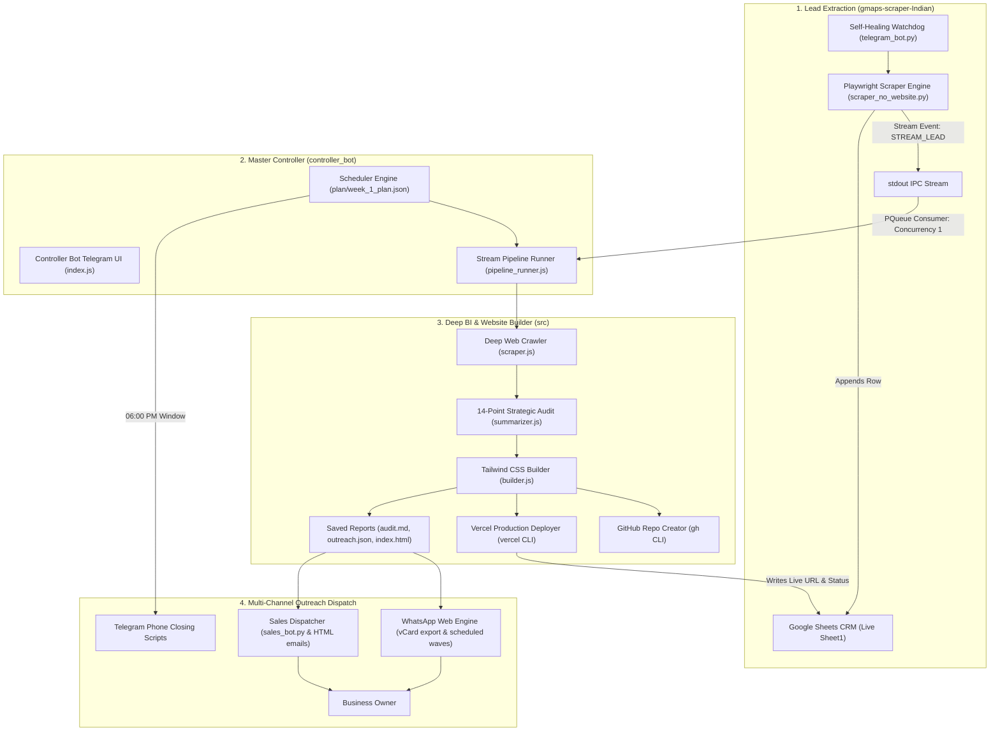

# 🌐 Arclane Studios — Autonomous Client Acquisition & Growth Ecosystem


An enterprise-grade, multi-agent autonomous system built specifically to capture, enrich, convert, and onboard Indian local businesses (Gyms, Salons, Spas, Clinics, Cafes) on 100% autopilot.

This comprehensive manual covers **literally everything**: from Google Maps scraping mechanics and real-time streaming architectures to website generation, Vercel deployments, WhatsApp automation, and server operations.

---

## 📑 Table of Contents

1. [System Architecture & Lifecycle](#1-system-architecture--lifecycle)
2. [Pillar 1: Google Maps AI Scraper (`gmaps-scraper-Indian`)](#2-pillar-1-google-maps-ai-scraper-gmaps-scraper-indian)
3. [Pillar 2: 24/7 Master Controller Bot (`controller_bot/`)](#3-pillar-2-247-master-controller-bot-controller_bot)
4. [Pillar 3: Business Intelligence & Website Builder (`src/`)](#4-pillar-3-business-intelligence--website-builder-src)
5. [Pillar 4: WhatsApp Web Curiosity Engine (`src/whatsapp_sender.js`)](#5-pillar-4-whatsapp-web-curiosity-engine-srcwhatsapp_senderjs)
6. [Pillar 5: Sales Email Dispatcher Bot (`sales_bot.py`)](#6-pillar-5-sales-email-dispatcher-bot-sales_botpy)
7. [Complete Command & CLI Reference](#7-complete-command--cli-reference)
8. [Google Sheets CRM Schema & Status Lifecycle](#8-google-sheets-crm-schema--status-lifecycle)
9. [Installation, Prerequisites & Environment Variables](#9-installation-prerequisites--environment-variables)
10. [24/7 Production Deployment & Zero-Crash Guide](#10-247-production-deployment--zero-crash-guide)
11. [Troubleshooting & Emergency Playbook](#11-troubleshooting--emergency-playbook)

---

## 1. System Architecture & Lifecycle

The ecosystem links two primary directories (`gmaps-scraper-Indian` and `business_intelligence_reporting_agent- Indian`) into a **Producer-Consumer Streaming Architecture**:



---

## 2. Pillar 1: Google Maps AI Scraper (`gmaps-scraper-Indian`)

Located at `../gmaps-scraper-Indian`. A military-grade Playwright scraper with multi-model AI inference (Gemini + OpenRouter) designed for multi-day uninterrupted execution.

### Key Components:
1. **`telegram_bot.py` (Command Center & Watchdog):**
   * Listens for remote Telegram commands to start/stop/pause scraping.
   * **The Watchdog:** Actively monitors scraper `stdout` logs. If Chromium hangs or deadlocks for $>3$ minutes, gracefully terminates the frozen process and respawns a fresh scraper resuming exactly where it stopped.
   * **Agent Smith Integration:** If enabled, autonomously asks LLMs for the next best query based on previous scrape counts and `instructions.txt`.
2. **`scraper_no_website.py` (Fast Leads Scraper):**
   * Specifically targets high-value businesses with missing or broken websites.
   * Extracts Name, Phone, Address, Timings, Rating, Review Count, Google Maps URL.
   * Cleans data with Gemini Flash Lite and writes directly to Google Sheets and local Excel.
   * Emits structured JSON events `[STREAM_LEAD]: {...}` for real-time consumer streaming.
3. **`scraper.py` (Deep Scraper with AI Reviews):**
   * Dual-pass review extraction (Most Relevant + Lowest Rating).
   * Generates custom pain-point outreach hooks.
4. **State Persistence:**
   * [`scraped_places.txt`](file:///C:/Users/Ameya%20Sharma/Downloads/gmaps-scraper-Indian/scraped_places.txt): Tracks all scraped Google Place URLs so restarts never process duplicate businesses.
   * [`google_maps_leads.xlsx`](file:///C:/Users/Ameya%20Sharma/Downloads/gmaps-scraper-Indian/google_maps_leads.xlsx): Local Excel backup compiled automatically upon job completion.

---

## 3. Pillar 2: 24/7 Master Controller Bot (`controller_bot/`)

Located at `controller_bot/`. The central autonomous coordinator that runs your weekly timetable on 100% autopilot.

### Daily Automated Schedule (`Asia/Kolkata`):
* **09:30 AM — ⚡ Real-Time Streaming Scrape & Build:**
  Spawns `scraper_no_website.py` for today's designated city and query. As each lead is extracted from Google Maps, it immediately triggers the deep crawl, 14-point audit, and Vercel website deployment for that lead in parallel while scraping continues.
* **10:30 AM — ⚙️ Safety Sweep Analysis:**
  Checks Google Sheets for any unprocessed or manually inserted leads and builds websites for them.
* **12:00 PM — 📲 Morning WhatsApp Dispatch Wave:**
  Pulls the first batch of 18 ready websites and dispatches curiosity messages via WhatsApp Web (30–75s safe delays).
* **04:30 PM — 📲 Afternoon WhatsApp Dispatch Wave:**
  Dispatches the remaining 17 leads during the late-afternoon engagement window.
* **06:00 PM — 📞 Deal-Closing Phone Alert:**
  Pushes follow-up reminders and Hindi/English phone scripts to your Telegram to close ₹7,999 deals over 2-minute calls.

### The Weekly Strategy Blueprint (`plan/week_1_plan.json`):
* **Monday:** Gyms & Fitness Centers in Pune (Target: 35 Leads)
* **Tuesday:** Fitness Studios & Gyms in Surat (Target: 35 Leads)
* **Wednesday:** Premium Unisex Salons in Gurugram (Target: 35 Leads)
* **Thursday:** Dental & Specialty Care Clinics in Ahmedabad (Target: 35 Leads)
* **Friday:** Fitness Gyms & CrossFit in Jaipur & Indore (Target: 35 Leads)
* **Saturday:** Spas & Wellness Studios in Chandigarh (Target: 35 Leads)
* **Sunday:** Lucknow Pipeline Review, Domain Mapping & Balance Collection

---

## 4. Pillar 3: Business Intelligence & Website Builder (`src/`)

### A. Deep Web Crawler (`src/scraper.js`)
* Crawls the prospect's existing online presence (homepage, `/about`, `/services`, `/contact`, `/blog`).
* Uses local Chrome channel to bypass anti-bot and cloud firewalls.
* Strips redundant markup and compresses text into strict 120k token budgets.

### B. 14-Point Strategic Audit (`src/summarizer.js` + `src/system_prompt.txt`)
* Uses OpenRouter (`openai/gpt-oss-120b`) / Gemini Flash Lite.
* Evaluates SWOT, Mobile UX Deficiencies, SEO gaps, Local Reputation, and generates SPIN sales hooks and an Antigravity responsive website design prompt.
* Saves markdown report to `reports/<clientId>/audit.md`.

### C. Website Builder & Vercel Deployer (`src/builder.js`)
* **Code Generation:** Converts the Antigravity prompt into a complete, responsive mobile-first Tailwind CSS website (`generated_sites/<clientId>/index.html`).
* **Design Quality Enforcement:**
  * Header is 100% solid/opaque (`bg-[#09090b]` or `bg-white`) with zero transparent overlay bugs.
  * Mobile drawer menu sits with top-11/12 breathing room, `rounded-tl-2xl` corner, backdrop blur overlay (`z-[90]`), and drawer `z-[100]`.
  * Fluid typography on H1/H2 (`text-2xl sm:text-4xl md:text-5xl lg:text-5xl xl:text-6xl break-words`) to prevent mobile word clipping.
  * Sticky mobile action bar with glowing Call Now and WhatsApp buttons (`pb-28` body padding).
* **Automated Git & Cloud Publishing:**
  * Initializes Git repository and publishes to GitHub (`gh repo create ameyasharma-ai/<slug> --public`).
  * Deploys live production website to Vercel (`npx vercel --prod --yes --project <slug>`).
  * Yields live public URL: `https://<business-slug>.vercel.app`.
* **Report Structuring:**
  * Writes structured metadata to `reports/<clientId>/outreach.json` and `outreach.txt`.
  * Updates Google Sheets with the live URL and sets status to `Website Built`.

---

## 5. Pillar 4: WhatsApp Web Curiosity Engine (`src/whatsapp_sender.js`)

* **Address Book vCard Exporter:** Exports batches of contacts as `.vcf` files so you can import them into your phone's address book with 1 tap.
* **Persistent Session:** Uses `whatsapp_user_session/` so you only scan the QR code once.
* **Anti-Ban Architecture:**
  * Randomized 30–75s interval between messages.
  * Human-like keystroke delays during text insertion.
  * Splits sends into 18 at 12:00 PM and 17 at 04:30 PM.
* **Curiosity-Driven Hook:** Sends a short, non-salesy message sharing their custom live demo website link.

---

## 6. Pillar 5: Sales Email Dispatcher Bot (`sales_bot.py`)

A stateless Python Telegram bot for email-based outreach:
* **Inline Button Navigation:** Sends `/scan` to browse all generated leads with pagination.
* **Rich HTML Templates:** Automatically wraps plain text drafts into styled HTML emails.
* **SEO Audit Attachment:** Parses `reports/<id>/audit.md`, renders it with a premium CSS stylesheet, and attaches it as `Website_UX_SEO_Audit.html`.
* **Anti-Duplication:** Checks Google Sheets notes to ensure no lead is emailed twice.

---

## 7. Complete Command & CLI Reference

### 🤖 A. Controller Bot Commands (`controller_bot/index.js`)

| Command / Action | Description | Example Usage |
| :--- | :--- | :--- |
| `/start` or `/menu` | Opens interactive dashboard with inline buttons | `/start` |
| `/status` | Shows real-time task state, running scrapers, and current timetable | `/status` |
| `/today` | Displays today's schedule, query, city, target count, and phone script | `/today` |
| `/start_auto` | Activates 24/7 autonomous cron schedule | `/start_auto` |
| `/pause_auto` | Suspends scheduled cron jobs (manual triggers still work) | `/pause_auto` |
| `/trigger_stream [query] [city] [count]` | **Launches concurrent real-time scrape & website build** | `/trigger_stream "Gyms" "Pune" 35` |
| `/trigger_scrape [query] [city] [count]` | Runs scraping only into Google Sheets | `/trigger_scrape "Dental Clinics" "Ahmedabad" 20` |
| `/trigger_analyse [maxLeads]` | Runs batch audit & website builds on unanalyzed leads | `/trigger_analyse 35` |
| `/trigger_send [count]` | Triggers an immediate WhatsApp dispatch wave | `/trigger_send 18` |

---

### 🔍 B. Google Maps Scraper Bot Commands (`gmaps-scraper-Indian/telegram_bot.py`)

| Command | Description | Example Usage |
| :--- | :--- | :--- |
| `/scrape [flags]` | Launches a new Google Maps scraping job | `/scrape --query "Gyms" --locality "in Pune" --city "Pune" --leads 35` |
| `/stop` | Safely terminates active scraper, shuts browser, compiles Excel | `/stop` |
| `/status` | View live heartbeat, RAM usage, and extracted leads count | `/status` |
| `/logs` | Returns the last 50 lines of live terminal output to Telegram | `/logs` |
| `/ping` | Health check verifying bot & Chromium state | `/ping` |
| `/pause [minutes]` | Temporarily sleeps scraper process without closing browser | `/pause 30` |
| `/resume` | Wakes scraper from paused state | `/resume` |

#### Scraper CLI Flags:
* `--query "keyword"`: Industry / category to search (e.g. `"Gyms"`, `"Unisex Salons"`).
* `--locality "in City"`: Maps search locality modifier (e.g. `"in Pune"`).
* `--city "CityName"`: City name for CRM tagging.
* `--leads N`: Number of leads to extract (default: 35).
* `--no_website`: Fast scraper variant targeting businesses without websites.
* `--no_agent_smith`: Disables autonomous LLM query generation upon completion.
* `--chunk_size N`: Flushes RAM cache every N leads.
* `--end_date YYYY-MM-DD`: Schedules automatic scraper stop date.

---

### ⚙️ C. Main Analyzer & Builder Bot Commands (`src/index.js`)

| Command | Description | Example Usage |
| :--- | :--- | :--- |
| `/analyse --range [x:y]` | Runs full web crawl, 14-point audit, and site build for range | `/analyse --range [1:35]` |
| `/send [x:y]` | Prepares vCard and dispatches WhatsApp messages for range | `/send [1:18]` |
| `/build <id>` or `build_<id>.txt` | Builds or rebuilds website for a specific Client ID | `/build 586` or `/build 586 --force` |
| `/login` | Opens WhatsApp Web browser window to scan QR code | `/login` |
| `/contacts [x:y]` | Exports `.vcf` vCard contact batch to Telegram chat | `/contacts [1:35]` |
| `/pause`, `/resume`, `/stop` | Controls active analysis pipeline | `/pause` |

---

### 📧 D. Sales Email Bot Commands (`sales_bot.py`)

| Command | Description | Example Usage |
| :--- | :--- | :--- |
| `/scan` | Opens interactive lead viewer with preview & email dispatch buttons | `/scan` |
| `/start` | Bot welcome message and usage instructions | `/start` |

---

## 8. Google Sheets CRM Schema & Status Lifecycle

### Column Structure:
1. `Client ID` (Sequential integer: 1, 2, 3...)
2. `Date Added` (`M/D/YY`)
3. `Business Name`
4. `Industry/Niche`
5. `City/State`
6. `Phone/WhatsApp`
7. `Website URL` (Populated with live `https://<slug>.vercel.app` after build)
8. `Email`
9. `Instagram`, `Facebook`, `X (Twitter)`, `YouTube`, `LinkedIn`
10. `Ratings` & `Number Of Reviews`
11. `Timings` & `Address`
12. `Maps URL`
13. `AI Outreach Hook` (Custom teaser sentence extracted from audit)
14. `Current Status` (See lifecycle below)
15. `Notes` (Path to report: `reports/<id>/audit.md`)

### Status Lifecycle Transitions:
```text
[Blank / Scraped] ──> [Website Built] ──> [Contacted - WhatsApp] ──> [Call Completed] ──> [Closed / Paid ₹7,999]
```

---

## 9. Installation, Prerequisites & Environment Variables

### Prerequisites:
* **Node.js:** v18+ or v20 LTS
* **Python:** 3.10+
* **Google Chrome:** Installed on host machine
* **GitHub CLI:** Authenticated via `gh auth login`
* **Vercel CLI:** Authenticated via `npx vercel login` (or `VERCEL_TOKEN`)
* **Google Service Account:** JSON credentials (`service_account.json`) invited as **Editor** to your Google Sheet.

### Installation:
```bash
# 1. Install Node.js dependencies
npm install

# 2. Install Python dependencies
pip install -r requirements.txt
pip install -r ../gmaps-scraper-Indian/requirements.txt (if applicable)

# 3. Setup Environment Variables
cp .env.example .env
```

### Environment Configuration (`.env`):
```env
# Telegram Bot Tokens (from @BotFather)
TELEGRAM_BOT_TOKEN="[REDACTED_TELEGRAM_TOKEN]"
CONTROLLER_BOT_TOKEN="[REDACTED_TELEGRAM_TOKEN]"
TELEGRAM_SALES_BOT_TOKEN="[REDACTED_TELEGRAM_TOKEN]"

# AI & LLM Keys
OPENROUTER_API_KEY="sk-or-v1-..."
API="gemini-api-key-here"

# Google Sheets Configuration
SPREADSHEET_NAME="Google Maps Leads"
WORKSHEET_NAME="Sheet1"
SERVICE_ACCOUNT_FILE="service_account.json"

# Email Configuration (Optional for sales_bot.py)
GMAIL_ADDRESS="your_email@gmail.com"
GMAIL_APP_PASSWORD="xxxx xxxx xxxx xxxx"

# Vercel Token (Optional if logged into Vercel CLI)
VERCEL_TOKEN="your_vercel_token"
```

---

## 10. 24/7 Production Deployment & Zero-Crash Guide

For 24/7 unattended VPS hosting (Ubuntu 24.04 on DigitalOcean, Oracle Cloud, or Azure):

### Step 1: Create 8 GB Virtual Swap (Prevents OOM Crashes)
```bash
sudo fallocate -l 8G /swapfile
sudo chmod 600 /swapfile
sudo mkswap /swapfile
sudo swapon /swapfile
echo '/swapfile none swap sw 0 0' | sudo tee -a /etc/fstab
```

### Step 2: Install PM2 Process Manager
```bash
sudo npm install -g pm2
```

### Step 3: Start All Bots with Auto-Restart Guards
```bash
# 1. Start Autonomous Controller Bot
pm2 start controller_bot/index.js --name "arclane-controller" --max-memory-restart 1G

# 2. Start Main Analyzer Bot
pm2 start src/index.js --name "arclane-analyzer" --max-memory-restart 1G

# 3. Start Google Maps Scraper Command Center
pm2 start "python telegram_bot.py" --name "gmaps-scraper" --cwd "../gmaps-scraper-Indian" --max-memory-restart 1G

# Save PM2 state for automatic reboot persistence
pm2 save
pm2 startup
```

### Useful PM2 Monitoring Commands:
```bash
pm2 status          # View status of all bots
pm2 logs            # View live combined logs
pm2 restart all     # Restart all bots
pm2 stop all        # Stop all bots
```

---

## 11. Troubleshooting & Emergency Playbook

| Issue | Root Cause | Solution |
| :--- | :--- | :--- |
| **WhatsApp Web asks for QR code** | Session expired or first-time setup | In Telegram Analyzer bot, send `/login` to open browser and scan QR code. |
| **Google Sheets 403 / Permission Denied** | Service account not invited | Open your Google Sheet $\rightarrow$ Share $\rightarrow$ Add service account email as **Editor**. |
| **Vercel deploy fails: `project add`** | Vercel token missing / expired | Run `npx vercel login` on host terminal or set `VERCEL_TOKEN` in `.env`. |
| **Scraper hangs or stalls** | Chromium memory deadlock | Watchdog will auto-restart within 3 min. To force restart, send `/stop` then `/scrape ...` in Telegram. |
| **GitHub CLI error: `gh repo create`** | Not authenticated with GitHub | Run `gh auth login` on the server and select HTTPS/Web authentication. |

---

## 📄 License & Proprietary Rights

Proprietary autonomous client acquisition platform developed by **Arclane Studios** (Founder: Ameya Sharma). All rights reserved.
