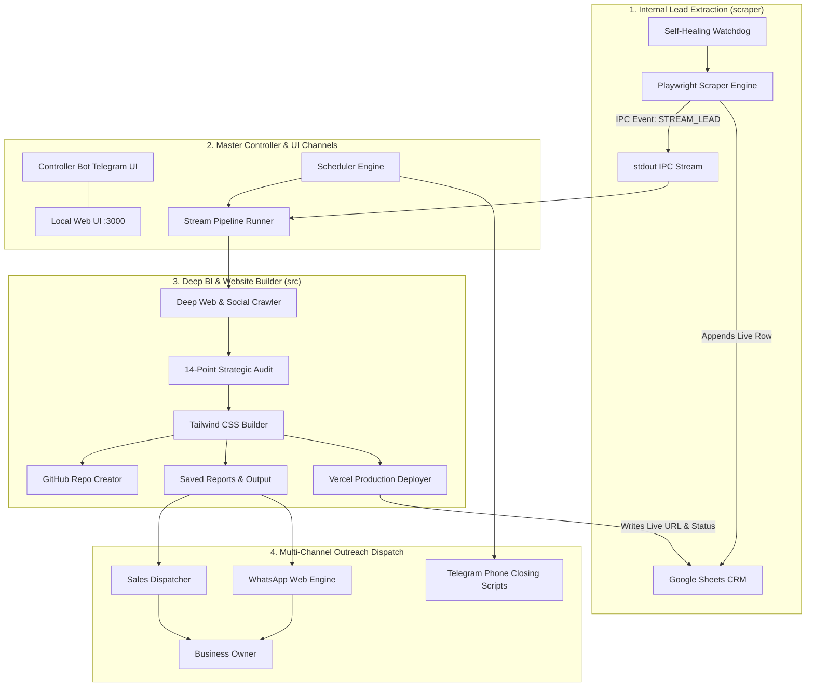

# 🌐 Arclane Studios — Autonomous Client Acquisition & Growth Ecosystem


An enterprise-grade, multi-agent autonomous system built specifically to capture, enrich, convert, and onboard Indian local businesses (Gyms, Salons, Spas, Clinics, Cafes) on 100% autopilot.

This comprehensive manual covers **the entire unified system:** from Google Maps scraping mechanics (now directly housed under `scraper/`) and real-time streaming architectures to website generation, Vercel deployments, WhatsApp automation, dual Telegram + Web UI control channels, and 24/7 server operations.

---

## 📑 Table of Contents

1. [System Architecture & Lifecycle](#1-system-architecture--lifecycle)
2. [Pillar 1: Google Maps AI Scraper (`scraper/`)](#2-pillar-1-google-maps-ai-scraper-scraper)
3. [Pillar 2: 24/7 Master Controller Bot (`controller_bot/`)](#3-pillar-2-247-master-controller-bot-controller_bot)
4. [Pillar 3: Dual Control Channel (Telegram Bot & Local Web UI)](#4-pillar-3-dual-control-channel-telegram-bot--local-web-ui)
5. [Pillar 4: Deep Business Intelligence & Website Builder (`src/`)](#5-pillar-4-deep-business-intelligence--website-builder-src)
6. [Pillar 5: WhatsApp Web Curiosity Engine (`src/whatsapp_sender.js`)](#6-pillar-5-whatsapp-web-curiosity-engine-srcwhatsapp_senderjs)
7. [Pillar 6: Sales Email Dispatcher Bot (`sales_bot.py`)](#7-pillar-6-sales-email-dispatcher-bot-sales_botpy)
8. [Complete Command & CLI Reference](#8-complete-command--cli-reference)
9. [Google Sheets CRM Schema & Status Lifecycle](#9-google-sheets-crm-schema--status-lifecycle)
10. [Installation, Prerequisites & Environment Variables](#10-installation-prerequisites--environment-variables)
11. [24/7 Production Deployment & Autostart (PM2 & Systemd)](#11-247-production-deployment--autostart-pm2--systemd)
12. [Troubleshooting & Emergency Playbook](#12-troubleshooting--emergency-playbook)

---

## 1. System Architecture & Lifecycle

The entire ecosystem is unified in this repository, linking the internal scraper (`scraper/`) and pipeline controller (`controller_bot/`) into a seamless **Producer-Consumer Streaming Architecture:** 



---

## 2. Pillar 1: Google Maps AI Scraper (`scraper/`)

Located directly inside `scraper/`. A military-grade Playwright scraper with multi-model AI inference (Gemini Flash Lite + OpenRouter) designed for multi-day uninterrupted execution.

### Key Components:
1. **`scraper_no_website.py` (Fast High-Value Hunter):**
   * Targets Indian local businesses with missing, invalid, or broken website links.
   * Extracts Name, Phone, Address, Timings, Rating, Review Count, and Google Maps URL.
   * **Multi-Source Phone Extraction:** Discovers Indian phone numbers via direct phone tags, WhatsApp `wa.me` URLs, `tel:` links, and whole-page DOM regex scanning (`+91`, `0`, 10-digit mobile).
   * Emits structured JSON events `[STREAM_LEAD]: {...}` via `stdout` for real-time consumer streaming.
2. **`scraper.py` (Deep Scraper with AI Reviews):**
   * Dual-pass review extraction (Most Relevant + Lowest Rating).
   * Analyzes customer pain points to generate precision sales hooks.
3. **`run_forever.py` (24/7 Memory-Safe Runner):**
   * Runs the scraper in controlled chunks (default: 50 leads per pass).
   * Gracefully closes Chromium and reclaims OS memory between chunks to eliminate memory leaks.
4. **`telegram_bot.py` (Standalone Scraper Command Center):**
   * Remote control of scraping jobs via dedicated Telegram commands.
   * Watchdog monitors Chromium output and auto-restarts the browser if deadlocked for $>3$ minutes.
5. **State & Deduplication:**
   * `scraped_places.txt`: Tracks all scraped Google Place URLs so restarts never process duplicate businesses.
   * `google_maps_leads.xlsx`: Local Excel spreadsheet compiled automatically after each job.

---

## 3. Pillar 2: 24/7 Master Controller Bot (`controller_bot/`)

Located in `controller_bot/`. The central autonomous coordinator that schedules and runs your daily timetable on 100% autopilot.

### Daily Automated Schedule (`Asia/Kolkata` Timezone):
* **09:30 AM — ⚡ Real-Time Streaming Scrape & Build:**
  Spawns `scraper/scraper_no_website.py` for today's designated city and query. As each lead is extracted from Google Maps, it immediately triggers the deep crawl, 14-point audit, and Vercel website deployment for that lead in parallel while scraping continues.
* **10:30 AM — ⚙️ Safety Sweep Analysis:**
  Checks Google Sheets for any unprocessed or manually inserted leads and builds websites for them.
* **12:00 PM — 📲 Morning WhatsApp Dispatch Wave:**
  Pulls the first batch of 18 ready websites and dispatches curiosity messages via WhatsApp Web (30–75s human delays).
* **04:30 PM — 📲 Afternoon WhatsApp Dispatch Wave:**
  Dispatches the remaining 17 leads during the late-afternoon engagement window.
* **06:00 PM — 📞 Deal-Closing Phone Alert:**
  Pushes follow-up reminders and Hindi/English phone scripts to Telegram/Web UI to close ₹7,999 deals over 2-minute calls.

### Weekly Strategic Plan (`plan/week_1_plan.json`):
* **Monday:** Gyms & Fitness Centers in Pune (Target: 35 Leads)
* **Tuesday:** Fitness Studios & Gyms in Surat (Target: 35 Leads)
* **Wednesday:** Premium Unisex Salons in Gurugram (Target: 35 Leads)
* **Thursday:** Dental & Specialty Care Clinics in Ahmedabad (Target: 35 Leads)
* **Friday:** Fitness Gyms & CrossFit in Jaipur & Indore (Target: 35 Leads)
* **Saturday:** Spas & Wellness Studios in Chandigarh (Target: 35 Leads)
* **Sunday:** Lucknow Pipeline Review, Domain Mapping & Balance Collection (Target: 20 Leads)

---

## 4. Pillar 3: Dual Control Channel (Telegram Bot & Local Web UI)

The ecosystem provides **redundant, zero-downtime management** through two synchronized interfaces:

1. **Telegram Controller Bot (`@ArclaneControllerBot`):**
   * Full remote control from any smartphone.
   * Inline buttons for one-tap execution (`/start`, `/status`, `/run_full`, `/abort`, etc.).
   * TLS fallback: If Telegram's polling socket disconnects, the system logs a warning without crashing.
2. **Local Web UI (`http://localhost:3000`):**
   * Built-in Express.js + Socket.IO offline interface.
   * **Full Feature Parity:** Supports all slash commands and interactive quick-action buttons.
   * **Bidirectional Chat Sync:** Messages, system notifications, and commands sent on Telegram reflect on the Web UI, and vice versa.
   * **Local History Persistence:** Preserves chat sessions across restarts in `web_ui_history.json`.

---

## 5. Pillar 4: Deep Business Intelligence & Website Builder (`src/`)

### A. Deep Web Crawler (`src/scraper.js`)
* Crawls the prospect's existing web presence (homepage, `/about`, `/services`, `/contact`, `/blog`).
* Employs Chromium stealth configurations to bypass anti-bot challenges and extract raw content.

### B. 14-Point Strategic Audit (`src/summarizer.js` + `src/system_prompt.txt`)
* Powered by Google Gemini Flash Lite / OpenRouter LLMs.
* Evaluates SWOT, Mobile UX Deficiencies, SEO gaps, Local Reputation, and generates SPIN sales hooks and responsive website design prompts.
* Writes markdown report to `reports/<clientId>/audit.md`.

### C. Website Builder & Vercel Deployer (`src/builder.js`)
* **Code Generation:** Converts the Antigravity prompt into a complete, responsive mobile-first Tailwind CSS website (`generated_sites/<clientId>/index.html`).
* **Design Quality Enforcement:**
  * Header is 100% solid/opaque (`bg-[#09090b]` or `bg-white`) with zero transparent overlay bugs.
  * Mobile drawer menu sits with top-11/12 breathing room, `rounded-tl-2xl` corner, backdrop blur overlay (`z-[90]`), and drawer `z-[100]`.
  * Fluid typography on H1/H2 (`text-2xl sm:text-4xl md:text-5xl lg:text-5xl xl:text-6xl break-words`) to prevent mobile word clipping.
  * Sticky mobile action bar with glowing Call Now and WhatsApp buttons (`pb-28` body padding).
* **Automated Git & Cloud Publishing:**
  * Initializes Git repository and publishes to GitHub (`gh repo create ameyasharma-ai/<slug> --public`).
  * Deploys live production website to Vercel (`npx vercel --prod --yes --project <slug>`).
  * Yields live public URL: `https://<business-slug>.vercel.app`.
* **Report Structuring:**
  * Writes structured metadata to `reports/<clientId>/outreach.json` and `outreach.txt`.
  * Updates Google Sheets with the live URL and sets status to `Website Built`.

---

## 6. Pillar 5: WhatsApp Web Curiosity Engine (`src/whatsapp_sender.js`)

* **Address Book vCard Exporter:** Exports batches of contacts as `.vcf` files so you can import them into your phone's address book with 1 tap.
* **Persistent Session:** Uses `whatsapp_user_session/` so you only scan the QR code once.
* **Anti-Ban Architecture:**
  * Randomized 30–75s intervals between messages.
  * Human-like keystroke delays during text insertion.
  * Splits sends into 18 at 12:00 PM and 17 at 04:30 PM.
* **Curiosity-Driven Hook:** Sends a short, non-salesy message sharing their custom live demo website link.

---

## 7. Pillar 6: Sales Email Dispatcher Bot (`sales_bot.py`)

A stateless Python Telegram bot for email-based outreach:
* **Inline Button Navigation:** Sends `/scan` to browse all generated leads with pagination.
* **Rich HTML Templates:** Automatically wraps plain text drafts into styled HTML emails.
* **SEO Audit Attachment:** Parses `reports/<id>/audit.md`, renders it with a premium CSS stylesheet, and attaches it as `Website_UX_SEO_Audit.html`.
* **Anti-Duplication:** Checks Google Sheets notes to ensure no lead is emailed twice.

---

## 8. Complete Command & CLI Reference

### 🤖 A. Master Controller Bot & Web UI Interactive Buttons Reference

The interactive dashboard (available both in Telegram and at `http://localhost:3000`) provides 1-tap execution buttons:

| Button / UI Control | Underlying Command / Action | Detailed Operational Function |
| :--- | :--- | :--- |
| **Live Status** | `/status` | **Health & Schedule Monitor:** Queries operational state, reporting whether Scraper or Pipeline Builder processes are active/idle, displays current IST time, and outlines today's cron executions. |
| **Today's Plan** | `/today` | **Daily Strategic Brief:** Reads `plan/week_1_plan.json`. Displays targeted niche (e.g. Dental Clinics in Ahmedabad), target lead quota (35), batch wave dispatches, and deal-closing phone scripts. |
| **360° Full Pipeline (1 Lead)** | `/run_full "Query" "City" 1` | **End-to-End Instant Demo:** Extracts exactly **1 qualified lead** from Google Maps, conducts 14-point AI audit, generates custom Tailwind CSS website, deploys live to Vercel, and immediately sends a curiosity WhatsApp pitch. |
| **Stream Scrape & Build** | `/trigger_stream [query] [city] [count]` | **Concurrent Streaming Pipeline:** Launches Playwright scraper for today's niche. As soon as 1 lead is extracted, it streams into builder queue to deploy the site while scraper continues searching in parallel. |
| **Reset & Resume 24/7 Plan** | `/reset_plan` | **State Reset:** Aborts active manual pipeline, flushes task queues, and restores autonomous 24/7 timetable. |
| **Abort Active Task** | `/abort` or `/stop` | **Emergency Halt:** Immediately transmits `SIGTERM` kill signal to all active Playwright, Puppeteer, and website builder child processes. |
| **WhatsApp Dispatch** | `/trigger_send [count]` | **Outreach Wave:** Connects to WhatsApp Web via persistent session (`whatsapp_user_session/`), retrieves next pending batch of leads with built sites, and messages them with 30-75s safe delays. |
| **🟢 Green Signal Gate** | Inline Button: `cmd_approve_dispatch` | **2-Step Safe Dispatch Approval:** At scheduled times (12:00 PM & 04:30 PM), the bot generates and exports a `.vcf` contact book to your Telegram/Web UI first, then pauses. WhatsApp messages are only sent once you tap **[🟢 Approve & Launch Wave]**. |
| **Scrape Only** | `/trigger_scrape [query] [city] [count]` | **Lead Extraction Only:** Scrapes Google Maps listings and writes them into Google Sheets (`Sheet1`). Does not trigger website builds or messaging. |
| **Build Only** | `/trigger_analyse [maxLeads]` | **Batch Site Generation:** Scans Google Sheets for unprocessed leads, executes 14-point AI SWOT audit, generates mobile-first sites, and deploys to Vercel. |
| **Pause / Resume Automation** | `/pause_auto` / `/start_auto` | **Cron Master Switch:** Toggles 24/7 autonomous cron schedule on or off without halting manual command triggers. |
| **View Schedule JSON** | `/view_plan` | **Configuration Inspector:** Shows file path (`plan/week_1_plan.json`) and instructions for reconfiguring daily niches, locations, and batch sizes. |

---

### 🔍 B. Google Maps Scraper Bot Commands (`scraper/telegram_bot.py`)

| Command | Description | Example Usage |
| :--- | :--- | :--- |
| `/scrape [flags]` | Launches a new Google Maps scraping job | `/scrape --query "Gyms" --locality "in Pune" --city "Pune" --leads 35` |
| `/stop` | Safely terminates active scraper, shuts browser, compiles Excel | `/stop` |
| `/status` | View live heartbeat, RAM usage, and extracted leads count | `/status` |
| `/logs` | Returns the last 50 lines of live terminal output to Telegram | `/logs` |
| `/ping` | Health check verifying bot & Chromium state | `/ping` |
| `/pause [minutes]` | Temporarily sleeps scraper process without closing browser | `/pause 30` |
| `/resume` | Wakes scraper from paused state | `/resume` |

#### Scraper CLI Flags:
* `--query "keyword"`: Industry / category to search (e.g. `"Gyms"`, `"Unisex Salons"`).
* `--locality "in City"`: Maps search locality modifier (e.g. `"in Pune"`).
* `--city "CityName"`: City name for CRM tagging.
* `--leads N`: Number of leads to extract (default: 35).
* `--no_website`: Fast scraper variant targeting businesses without websites.
* `--no_agent_smith`: Disables autonomous LLM query generation upon completion.
* `--chunk_size N`: Flushes RAM cache every N leads.
* `--end_date YYYY-MM-DD`: Schedules automatic scraper stop date.

---

## 9. Google Sheets CRM Schema & Status Lifecycle

### Column Structure:
1. `Client ID` (Sequential integer: 1, 2, 3...)
2. `Date Added` (`M/D/YY`)
3. `Business Name`
4. `Industry/Niche`
5. `City/State`
6. `Phone/WhatsApp`
7. `Website URL` (Populated with live `https://<slug>.vercel.app` after build)
8. `Email`
9. `Instagram`, `Facebook`, `X (Twitter)`, `YouTube`, `LinkedIn`
10. `Ratings` & `Number Of Reviews`
11. `Timings` & `Address`
12. `Maps URL`
13. `AI Outreach Hook` (Custom teaser sentence extracted from audit)
14. `Current Status` (See lifecycle below)
15. `Notes` (Path to report: `reports/<id>/audit.md`)

### Status Lifecycle Transitions:
```text
[Blank / Scraped] ──> [Website Built] ──> [Contacted - WhatsApp] ──> [Call Completed] ──> [Closed / Paid ₹7,999]
```

---

## 10. Installation, Prerequisites & Environment Variables

### Prerequisites:
* **Node.js:** v18+ or v20 LTS
* **Python:** 3.10+
* **Google Chrome / Chromium:** Installed on host machine
* **GitHub CLI:** Authenticated via `gh auth login`
* **Vercel CLI:** Authenticated via `npx vercel login` (or `VERCEL_TOKEN`)
* **Google Service Account:** JSON credentials (`service_account.json`) invited as **Editor** to your Google Sheet.

### Installation:
```bash
# 1. Install Node.js dependencies
npm install

# 2. Install Python dependencies (Root and Scraper)
pip install -r requirements.txt

# 3. Setup Environment Variables
cp .env.example .env
```

### Environment Configuration (`.env`):
```env
# Telegram Bot Tokens (from @BotFather)
TELEGRAM_BOT_TOKEN="your_nodejs_scraper_bot_token"
CONTROLLER_BOT_TOKEN="your_controller_bot_token"
TELEGRAM_SALES_BOT_TOKEN="your_python_sales_bot_token"

# AI & LLM Keys
OPENROUTER_API_KEY="sk-or-v1-..."
API="gemini-api-key-here"

# Google Sheets Configuration
SPREADSHEET_NAME="Google Maps Leads"
WORKSHEET_NAME="Sheet1"
SERVICE_ACCOUNT_FILE="service_account.json"

# Email Configuration (Optional for sales_bot.py)
GMAIL_ADDRESS="your_email@gmail.com"
GMAIL_APP_PASSWORD="xxxx xxxx xxxx xxxx"

# Vercel Token (Optional if logged into Vercel CLI)
VERCEL_TOKEN="your_vercel_token"
```

---

## 11. 24/7 Production Deployment & Autostart (PM2 & Systemd)

For 24/7 unattended execution on Ubuntu VPS (DigitalOcean, AWS, Oracle Cloud):

### Step 1: Create 8 GB Virtual Swap (Prevents Out-Of-Memory Crashes)
```bash
sudo fallocate -l 8G /swapfile
sudo chmod 600 /swapfile
sudo mkswap /swapfile
sudo swapon /swapfile
echo '/swapfile none swap sw 0 0' | sudo tee -a /etc/fstab
```

### Step 2: Install PM2 Process Manager
```bash
sudo npm install -g pm2
```

### Step 3: Start Services with PM2
```bash
# 1. Start Autonomous Controller Bot & Web UI
pm2 start controller_bot/index.js --name "arclane-controller" --max-memory-restart 1G

# 2. Start Main Analyzer Bot
pm2 start src/index.js --name "arclane-analyzer" --max-memory-restart 1G

# 3. Start Google Maps Scraper Command Center
pm2 start "python scraper/telegram_bot.py" --name "gmaps-scraper" --max-memory-restart 1G

# 4. Save PM2 configuration to survive server reboots
pm2 save
pm2 startup
```

### Useful Monitoring Commands:
```bash
pm2 status          # View status of all bots
pm2 logs            # View live combined logs
pm2 restart all     # Restart all bots
pm2 stop all        # Stop all bots
```

---

## 12. Troubleshooting & Emergency Playbook

| Issue | Root Cause | Solution |
| :--- | :--- | :--- |
| **WhatsApp Web asks for QR code** | Session expired or first-time setup | Run `/login` to open the browser window and scan the QR code once. |
| **Google Sheets 403 / Permission Denied** | Service account not invited | Share your Google Sheet with the `client_email` in `service_account.json` as **Editor**. |
| **Vercel deploy fails: `project add`** | Vercel token missing or expired | Run `npx vercel login` or set `VERCEL_TOKEN` in `.env`. |
| **Scraper hangs or stalls** | Chromium memory deadlock | Watchdog auto-restarts within 3 min. To force restart, send `/abort` and re-run. |
| **Telegram Polling Error / Disconnect** | Network TLS glitch or proxy issue | The bot logs the error and gracefully falls back to the Local Web UI at `http://localhost:3000`. |
| **GitHub CLI error: `gh repo create`** | Not authenticated with GitHub | Run `gh auth login` on the host machine. |

---

## 📄 License & Proprietary Rights

Proprietary autonomous client acquisition platform developed by **Arclane Studios** (Founder: Ameya Sharma). All rights reserved.
