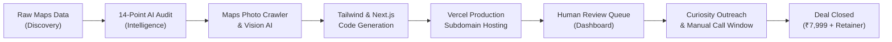
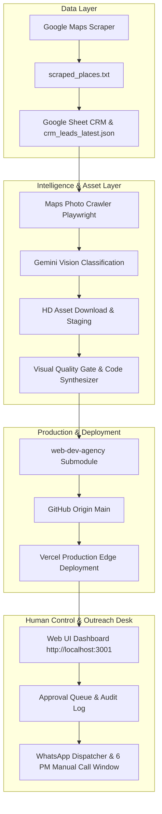
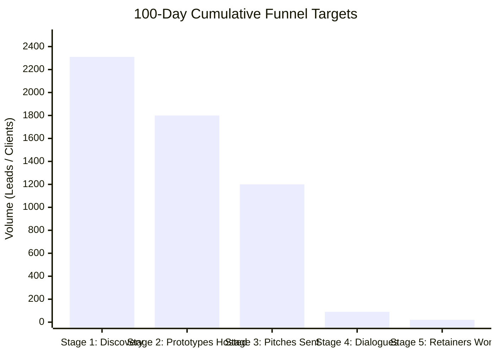

# ArcLane Studios — Business Model & Client Acquisition Intelligence
**Autonomous Sales OS, Conversion Engineering & Unit Economics Architecture**

---

## 1. Executive Overview & Company Identity

**ArcLane Studios** (`https://www.arclanestudios.space`) is an engineering-first digital acquisition agency and software platform founded by **Ameya Sharma**. 

Unlike conventional digital marketing agencies or freelance web designers who pitch speculative ideas or assemble sluggish WordPress/Wix templates, ArcLane Studios operates on an **autonomous, engineering-led B2B growth model**. We combine real-time scraping, computer vision intelligence, custom React/Next.js/Tailwind development, and automated cloud deployments to deliver functional web applications to local business owners *before* requesting a single rupee or asking for a sales call.

### The Core Differentiator
- **Zero Generic Templates:** Every delivered website is compiled with clean semantic Tailwind CSS, high-contrast typography, un-tinted authentic photography, and fluid responsive design (360px mobile up to 4K desktop).
- **Zero Speculative Pitching:** Rather than sending cold emails asking *"Do you need a website?"*, we deploy a live, high-converting prototype on `https://www.arclanestudios.space/sites/{slug}` featuring the client's actual Google Maps photos, Google rating stars, address, and interactive WhatsApp appointment buttons.
- **Immediate Value Realization:** When the owner opens the link on their mobile device, the psychological objection shifts from *"Do I need digital presence?"* to *"How do I connect my own domain and keep this live?"*.

---

## 2. The "Value-First" Acquisition Framework

### Psychological Principle: *"Dekho Phir Faisla Karo"* (Inspect First, Decide Later)
Small and medium businesses (SMBs) in India are inundated with low-tier telemarketers demanding ₹15,000–₹50,000 upfront with zero tangible proof of competence. ArcLane Studios completely removes friction and perceived risk through a 6-stage lifecycle:

1. **Autonomous Discovery:** High-intent local businesses in designated city clusters are discovered via Google Maps.
2. **AI Gap Analysis:** Gemini models analyze their review profiles, competitor density, and missing mobile lead capture touchpoints.
3. **Automated Prototype Manufacturing:** The engine extracts authentic Google Maps photos, runs Gemini Vision AI to classify showcase and interior shots, downloads HD assets, and compiles a complete, mobile-first website in seconds.
4. **Live Subdomain Hosting:** Deployed to Vercel production hosting, generating an immediate, shareable preview URL.
5. **Human Gatekeeper Approval:** The operator reviews the website and message copy on the executive dashboard before dispatching.
6. **Curiosity Hook Dispatch:** The prospect receives a brief, respectful message containing their live preview link. No aggressive selling—just pure proof of work.

---

## 3. Ideal Client Profile (ICP) & Target Segmentation

ArcLane targets established Indian SMBs in high-ticket consumer services where a single new client or booking represents substantial revenue:

| Industry / Niche | Target Business Profile | High-Converting Feature | Key Commercial Hook |
|---|---|---|---|
| **Gyms & Strength Hubs** | $>40$ Google Reviews, $\ge 4.5★$, missing or broken website | 2-button sticky mobile bar (`Call Now` + `WhatsApp Free Trial`) | *"Patliputra Colony prospects search on Google Maps daily—convert walk-ins with a 1-tap trial booking page."* |
| **Cafes & Specialty Bakeries** | $>50$ Reviews, high food photo volume, active evening footfall | Split-hero showcase card with signature dishes + instant location embed | *"Showcase your signature menu dishes and live directions directly on mobile."* |
| **Unisex Salons & Luxury Spas** | Established clientele, high average order value (AOV) | Clean service menu cards with direct WhatsApp appointment booking | *"Enable clients to review treatment packages and book slots without phone tag."* |
| **Dental & Specialty Clinics** | High trust requirement, doctor credentials, patient inquiries | Doctor bio, Google reviews carousel, 1-tap consultation request | *"Build patient trust before their visit with doctor credentials and verified patient reviews."* |

### Geographic Focus
- **Tier-1 / Tier-2 Growth Metros:** Patna, Pune, Surat, Gurugram, Ahmedabad, Jaipur, Indore, Chandigarh, Lucknow.
- **Micro-Locality Hopping:** Boring Road, Kankarbagh, Patliputra Colony, Fraser Road, Bailey Road (Patna) and similar dense economic commercial corridors.

---

## 4. The 6-Stage Autonomous Revenue Architecture

### Stage 1: Discovery & Ingestion
- Playwright-driven stream scraper queries target niches and localities.
- Micro-locality boundary hopping prevents zero-result dropouts by switching to neighboring sectors upon exhausting result sets.
- Strict deduplication ensures businesses are never re-scraped or contacted twice.

### Stage 2: Intelligence & Photo Classification
- Crawls authentic Google Maps photos directly from the business listing.
- **Gemini Vision** classifies images into:
  - `hero`: Clean interior ambiance or signature dish/service.
  - `featured`: Equipment, interior zones, dining rooms.
  - `discard`: Outdoor street hoarding, neighbor shops, low-res or blurry images.
- If real photos lack sufficient resolution, verified stock fallbacks are seamlessly injected.

### Stage 3: Visual Quality Gate & Compilation
- Generates clean, zero-distortion HTML5/Tailwind code with strict UX guarantees:
  - **100% Solid Opaque Header:** Prevents hero content collisions and illegible overlapping navigation links.
  - **Balanced Centered Nav:** Protected brand margin (`mr-4 lg:mr-8`), centered flex navigation (`mx-auto`), and uncollided CTA buttons.
  - **Desktop Split-Hero Showcase:** 60/40 split with un-tinted 100% vibrant photography, house signature badges, and live open status chips.
  - **Mobile 2-Button Bottom Bar:** Strict 2-button limit (`Call Now` + `WhatsApp Trial`) with `whitespace-nowrap` on mobile screens.

### Stage 4: Batched Cloud Deployment
- Staged into `web-dev-agency/public/sites/{slug}/index.html`.
- Batched every 5 leads to preserve Vercel's Hobby deployment quotas (100 deploys/day max).
- Primary live URL recorded in Google Sheets CRM as `https://www.arclanestudios.space/sites/{slug}`.

### Stage 5: Human Gatekeeper Approval Desk
- Hosted at `http://localhost:3001` with bi-directional Telegram synchronization.
- Ameya reviews generated websites, tailors personalized pitch copy, and approves/rejects leads before dispatch.

### Stage 6: Multi-Stage Outreach Cadence
- **Wave 1:** 12:00 PM IST (WhatsApp curiosity preview).
- **Wave 2:** 04:30 PM IST (Secondary review wave).
- **Wave 3:** 06:00 PM IST (Manual Phone Calling window offering "No-Risk Free Gift").
- **Automated Cadence:** +2 days, +4 days, +7 days follow-ups, halting immediately upon prospect reply.

---

## 5. Commercial Pricing & Unit Economics

### Commercial Offerings
1. **The "Live Mobile Preview" Activation Package:**
   - **Setup Fee:** Flat ₹4,999 to ₹7,999 one-time.
   - **Deliverables:** Permanent ownership of the mobile-first website, custom `.com` or `.in` domain setup, Google Maps embedding, 1 full year of managed hosting + SSL certificate, and direct WhatsApp lead capture.
2. **Monthly Growth Retainer (Post-Launch):**
   - **Retainer Fee:** ₹799 to ₹1,499 / month.
   - **Services:** Monthly menu/pricing revisions, seasonal banner updates, Google Business Profile local SEO optimization, speed maintenance, and uptime monitoring.

### Unit Economics Breakdown
- **Cost of Goods Sold (COGS) per Site:**
  - Vercel Edge Hosting: **₹0** (Free / Pro multi-tenant)
  - GitHub Repository Management: **₹0** (Free tier)
  - Google Maps Ingestion: **₹0** (Local Playwright headless session)
  - Gemini Vision & Code API: **~₹3.50 ($0.04)** per lead
- **Gross Profit Margin:** **>96%**
- **Settlement:** Immediate direct UPI bank settlement on approval.

---

## 6. 100-Day Target Conversion Funnel

- **Stage 1 (Discovery):** ~2,310 Ingested leads (33 leads/day across Patna and target clusters).
- **Stage 2 (Prototypes Hosted):** ~1,800 Deployed live on `arclanestudios.space/sites/*`.
- **Stage 3 (Outreach Dispatches):** ~1,200 Reviewed and approved pitches.
- **Stage 4 (Dialogues / Warm Replies):** 60–100 Conversions (~5% response rate).
- **Stage 5 (Paying Retainers):** **15 to 20 Paying Clients** generating **₹1,20,000 to ₹1,60,000+** in initial setup and recurring retainer revenue.

---

## 7. Daily 24/7 Operational Schedule

| Time (IST) | Component | Action | Expected Output |
|---|---|---|---|
| **06:00 AM** | `stream_scraper` & `builder` | Morning scraping, Gemini audit, and automated Vercel deployment | 33 fresh high-quality leads built and hosted |
| **07:30 AM** | `safety_sweep` | Cross-checks Google Sheets CRM, validates links, flags anomalies | Clean CRM with verified deployed URLs |
| **12:00 PM** | `whatsapp_dispatcher` | Wave 1 curiosity hook dispatch to approved queue | Outbound messages sent to warm phone numbers |
| **04:30 PM** | `whatsapp_dispatcher` | Wave 2 curiosity hook dispatch | Afternoon outreach batch |
| **06:00 PM** | Manual Call Desk | High-close manual calling window using the *"No-Risk Free Gift"* script | Phone dialogues and deal closing |
| **08:00 PM** | `follow_up_engine` | Automated cadence dispatch (+2d, +4d, +7d) | Re-engages non-responders, halts on reply |

---

## 8. Safety & Quota Safeguards

1. **Vercel Hobby Deployment Guard:** Capped at 100 deploys/day. The engine stages builds in batches of 5 to preserve daily quotas.
2. **Google Maps Anti-Scrape Throttling:** 5-second cooling buffer between automated browser queries prevents IP-level shadow bans.
3. **Gemini Free-Tier Rate Limiting:** Built-in p-retry with exponential backoff guarantees compliance with the 15 RPM free ceiling.
4. **Instant Emergency Controls:** Global Kill Switch (`/abort`) and 24/7 scheduler pause toggles available across Telegram and Web UI.
