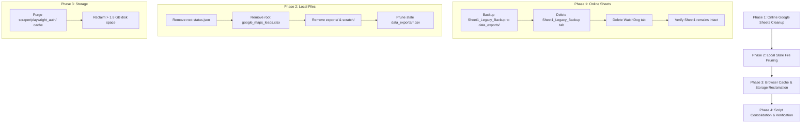

# Plan: Safe Cleanup of Unnecessary Files, Folders & Online Sheets

> [!IMPORTANT]
> **Safety First:** This is an audit and execution plan only. **No files, directories, or Google Sheets tabs have been deleted or modified.** All operations outlined below will only proceed upon your review and explicit approval.

---

## 1. Why Leads After 500th Looked Unedited in the Screenshot

Looking at the screenshot of your browser:
1. **The Row Is Already Updated Online:**
   - In your screenshot, Row 502 shows `The Lifeline Gym` (Client ID 504), Row 503 shows `SAMRAT FITNESS` (Client ID 502), Row 504 shows `FIT INDIA GYM` (Client ID 503), Row 505 shows `Bake n Bite bliss` (Client ID 501), and Row 506 shows `i-Nex GYM [BIHTA]` (Client ID 505).
   - This proves the re-ordering and rank synchronization **did succeed** on the sheet!
2. **Why Priority / Ratings Looked "Missing":**
   - In Google Sheets, columns A through H (`Client ID` through `Existing Website`) are displayed in your current viewport.
   - The columns `Priority Level`, `Ratings`, and `Number Of Reviews` are in **Columns J, K, and L** (further to the right).
   - Because columns A to H take up the horizontal width of your browser screen, columns J, K, and L are off-screen to the right and only become visible when scrolling horizontally.
   - Furthermore, browser tab caching often retains the previous cell views until you refresh the tab (`F5` / `Ctrl+R`).

---

## 2. Analysis of Online Google Sheets Tabs

Your Google Spreadsheet document (`Google Maps Leads`) currently contains 4 tabs:

| Tab Name | Row/Col Dimensions | Description & Purpose | Needed? | Recommendation |
| :--- | :--- | :--- | :---: | :--- |
| **`Sheet1`** | 1,350 rows × 54 cols | **Primary Live CRM.** Contains all 505 active leads, deployed URLs, hooks, audit notes, ratings, reviews, and priority levels. Every engine script (`src/sheets.js`, `src/engine/instant_maps_builder.js`, etc.) reads and writes to this tab. | **YES (CRITICAL)** | **Retain permanently.** |
| **`Sheet1_Legacy_Backup`** | 1,013 rows × 56 cols | Created on Nov 1 during the automated schema migration (`scripts/migrate_live_crm_schema.js`). It is a historical snapshot of the old, un-migrated column structure. | **NO** | Can be exported to a local backup file and safely **deleted from Google Sheets** to declutter the workbook. |
| **`WatchDog`** | 10 rows × 10 cols | Stale 10x10 scratch grid with a single cell reading `"IDLE"`. No active engine script or cron references this tab. | **NO** | Safe to **delete**. |
| **`Arclane Outreach CRM Dashboard`** | Object / Chart Sheet | Google Sheets embedded chart/summary dashboard view created for manual inspection. Does not affect Node.js backend. | **OPTIONAL** | Keep if you like the visual chart tab in Google Sheets; delete if you only use the local web UI (`http://localhost:3000`). |

---

## 3. Codebase & Filesystem Audit

### Category A: Root Directory Stale Artifacts (Zero Impact on System)
These files were created during initial manual testing or single-run scripts and are no longer referenced:

1. **`status.json`** (Root):
   - Created on Sept 23, 2026 (`{"current_lead": "DOYEN THE GYM", "leads_extracted": 0, "target": 1}`).
   - The active scraper lives in `scraper/` and writes to `scraper/status.json`. Root `status.json` is dead.
2. **`google_maps_leads.xlsx`** (Root):
   - Stale manual spreadsheet export from October 30. The single source of truth is Google Sheets CRM + `data_exports/crm_leads_latest.json`.
3. **`exports/`** (`contacts.csv`, `contacts.vcf`):
   - One-off contact card exports from early tests.
4. **`scratch/`** (29 files, ~50 KB):
   - Temporary debugging scripts (`check_bot_token.cjs`, `compare_tokens.cjs`, `clean_audit.cjs`, `deep_codebase_audit.cjs`, etc.).
5. **`scraper/scraper.log`**:
   - Stale legacy scraper terminal output from September.

---

### Category B: Redundant Data Exports & Backups (~12 MB)
Inside `data_exports/`, there are multiple redundant CSV snapshots generated during initial batch runs:
- `crm_leads_500_2026-10-31T10-57-15-643Z.csv`
- `crm_leads_500_2026-10-31T11-06-02-961Z.csv`
- `crm_leads_500_2026-11-01T05-55-06-355Z.csv`
- `crm_leads_500_2026-11-01T07-04-00-673Z.csv`
- `crm_leads_500_2026-11-01T07-11-39-426Z.csv`
- `crm_leads_latest.csv` *(The JSON version `crm_leads_latest.json` is what the dashboard and builder actually use)*.

**Action:** Keep `data_exports/crm_leads_latest.json` and archive/remove stale timestamped CSV duplicates.

---

### Category C: Heavy Browser Cache & Auth Profiles (~2.4 GB Disk Space)
These are git-ignored, automatically recreated on demand, but consume significant local storage:

| Path | Size | Description | Safe to Clean? |
| :--- | :--- | :--- | :--- |
| `scraper/playwright_auth/` | **~1,178 MB** | Residual Playwright browser profile data and disk cache from bulk scraping. | **YES** (auto-recreates when scraper runs) |
| `chrome_profile/` | **~535 MB** | Profile and cache directory used by local Playwright visual quality gates and screenshots. | **YES** (cache wipe, auto-recreates) |
| `playwright_auth/` | **~103 MB** | Root Playwright session cache. | **YES** |
| `whatsapp_user_session/` | **~590 MB** | WhatsApp Web browser session files. | ⚠️ **DO NOT DELETE** if you have an active QR code sign-in you want to keep; delete only if you want to re-scan QR. |
| `whatsapp_session/` | **~48 MB** | Baileys/WhatsApp socket cache. | ⚠️ **DO NOT DELETE** if actively authenticated. |

---

### Category D: One-Off Scripts in `scripts/`
The `scripts/` directory currently contains 124 files (~500 KB). Many are single-use verification scripts from previous troubleshooting milestones:
- `clean_manipal.js`, `check_live_drmonika.js`, `fix_drmonika_and_scan.js`
- `test_gymparadox_fix.js`, `test_googly_footer.cjs`, `inspect_lafumee.js`
- `rebuild_lead1_site.js`, `update_lead1_assets.js`

**Action:** Consolidate reusable production scripts (like `auto_commit.js`, `rank_and_sync_new_leads.js`, `instant_maps_builder.js`) and move one-off test scripts into an `archive/` or delete them.

---

## 4. Proposed Execution Phases

---

## 5. Verification & Safety Guarantees

1. **No Outbound Impact:** The core engine (`src/`), the Express dashboard (`src/web_ui.js`), the Telegram controller bot (`controller_bot/`), and all 504 deployed websites in `web-dev-agency/` will remain completely untouched.
2. **Sheet Safety:** Only `Sheet1` is used by the application code. Removing `Sheet1_Legacy_Backup` and `WatchDog` will make the Google Sheet cleaner, faster to load, and easier to navigate.
3. **Rollback Availability:** Before any online tab deletion, a complete snapshot of all tabs will be saved locally in `data_exports/`.
